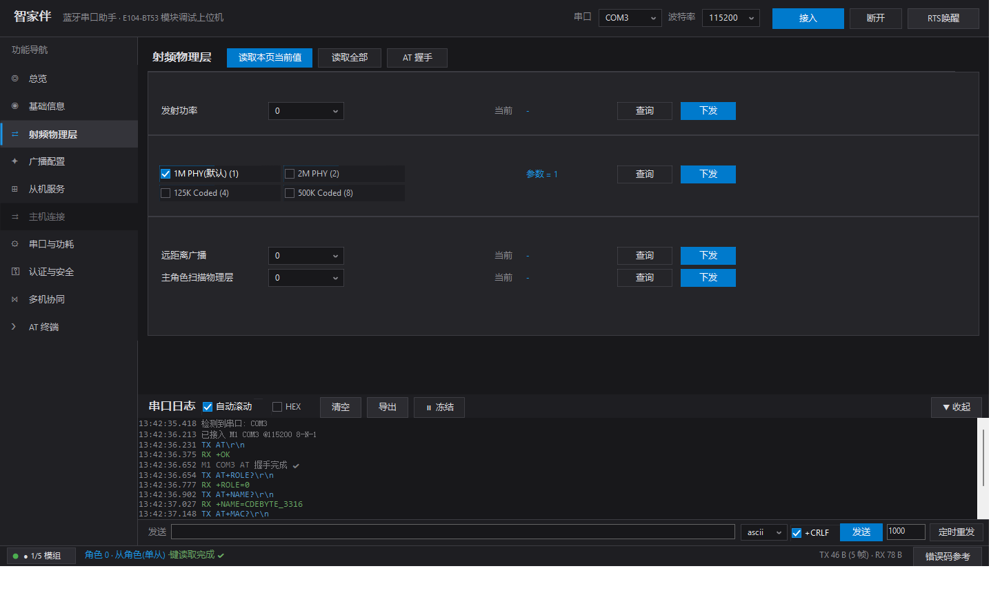

# EBYTE-E104 · 智家伴蓝牙串口助手

> 面向 **成都亿佰特 E104-BT53**(BLE 5.2 串口透传模组)的 Windows 调试上位机。
> 完整覆盖《E104-BT53 产品规格书 CN v1.6》第六章 **全部 33 组 AT 指令**,支持 **≤5 个模组同时接入**、
> 主从自动分配与点对点连接。



---

## ✨ 功能特性

### 指令覆盖
- **33 组 AT 指令全覆盖**(6.3.1 ~ 6.3.33):名称/MAC/角色/功率/广播/扩展广播/Beacon/Service UUID/
  扫描/连接/透传/自动重连/观察者/波特率/连接间隔/休眠/看门狗/复位/恢复出厂/认证等
- 每条参数带 **规格书描述悬浮提示**(取值范围 / 默认值 / 生效方式 / 掉电保存 / 角色限制)
- **交互式两步指令**分步引导:`AT+ADV_EXT`(扩展广播)、`AT+SEND`(发送数据)
- **角色感知**:从角色下自动置灰主角色专用页,可勾选"强制允许"实测错误码
- 错误码 `+ERR=1/2/3/4` **即时翻译**,内置实测差异提示

### 多模组协同(≤5 路)
- 顶栏逐个 **[接入]**,最多 5 个串口并行,各自独立会话、日志自动加 `[COMx]` 前缀
- **主从自动分配**:① 预演方案 → ② 应用(写 `AT+ROLE`)→ ③ 点对点连接
- **点对点连接**:任选两台,自动判定主从,主机扫描后按 MAC 发起 `AT+CONNECT`
- 一键"全部恢复从角色"

### 串口助手能力
- 实时日志:TX 蓝 / RX 绿 / 事件橙 / 错误红,毫秒时间戳
- **HEX 原始字节流**、**⏸冻结/▶解冻**、**TX/RX 字节计数**、日志导出
- 手动发送栏:ASCII/HEX、`+CRLF` 开关(勾=AT 指令 / 不勾=透传)、Enter 发送、↑↓ 历史、定时重发
- 可拖动分隔条调节日志高度、一键收起

### 工程保护
- **应答等待 + 20ms 最小帧间隔**,杜绝指令粘连(实测 `AT+ROLE?×2` 会触发 `+ERR=1`)
- 危险操作分级确认:复位 / 恢复出厂(二次确认) / 波特率 / 关闭串口
- 连接间隔自动换算 ms(参数 ×1.25)、PHY 位域勾选求和、MAC 6 字节强校验

---

## 🚀 快速开始

### 运行(推荐)
1. 双击 `智家伴蓝牙串口助手.exe`(如未构建,先执行下一步)
2. 顶栏选择串口 → 波特率(默认 115200)→ 点击 **[接入]**
3. 自动握手并读取 角色/名称/MAC/固件版本

### 构建
```bat
:: 双击 build.bat,或命令行执行
build.bat
```
- **零依赖**:使用系统自带 `.NET Framework 4.8` 的 `csc.exe`,无需 .NET SDK / NuGet
- 产物:`智家伴蓝牙串口助手.exe`、`TestProto.exe`、`TestMulti.exe`

### 在 Visual Studio 中开发
新建 **Windows Forms 应用(.NET Framework 4.8)** 项目,把 `src/*.cs` 全部加入即可。
源码使用 **C# 5 语法**(兼容旧编译器),无第三方包依赖。

---

## 📁 目录结构

```
.
├── build.bat                  一键编译(系统 csc,零依赖)
├── src/                       主程序源码
│   ├── program.cs             入口:DPI 感知 / 深色标题栏 / 自绘图标 / 崩溃记录
│   ├── ui_theme.cs            自绘控件库:FlatBtn / NavBtn / Card / Chip / DarkCombo /
│   │                          DarkCheck / DarkRadio / FlowRow / GridRows / DarkTips
│   ├── serial_io.cs           串口引擎 + 协议会话层(行组装/应答等待/流式路由)
│   ├── multi_device.cs        多模组管理 + 主从/点对点规划器
│   ├── main_form.cs           主窗体:壳层布局 + 总览/基础/射频页
│   ├── pages_extra.cs         广播/服务/主机/串口功耗/认证/终端页
│   ├── pages_multi.cs         多机协同页
│   ├── test_proto.cs          AT 协议自检(需真机)
│   └── test_multi.cs          多机分配逻辑自检(无需硬件)
├── tools/                     辅助工具源码(窗口截图 / 尺寸调整)
├── docs/                      使用说明与截图
└── legacy/python/             早期 Python + Tkinter 实现(留档)
```

---

## 🧪 自检

```bat
:: 多机分配逻辑(无需硬件)
TestMulti.exe      → 7 项断言

:: AT 协议回归(模组接在 COM3)
TestProto.exe      → 握手 / 18 组查询 / 设置回读 / 错误码 / 交互式两步下发
```

---

## 📌 实测差异备忘(固件 7413-1-16 / A3)

| 项 | 规格书写法 | 实测 |
|---|---|---|
| `AT+VERSION?` | `+OK=7413-x-xx` | **`+VERSION=7413-1-16`** |
| `AT+TRM_HANDLE?` 无连接 | `+OK=NULL` | **`+TRM_HANDLE=255`** |
| `AT+DEV_DEL` 删除不存在 MAC | `+ERR=3` | **`+ERR=2`** |
| `AT+CONNECT` 示例 MAC | 5 字节 | 被拒 **`+ERR=2`**,须 6 字节 |
| `AT+AUTH`(串口发) | — | **`+ERR=4`**(仅 APP 通道有效,正常) |
| 毫秒级连发两条指令 | 未提及 | **粘连 → `+ERR=1`** |

> A1 版本额外限制:不支持 `LE_CODED` / `SCAN_PHY` / OTA,最大发射功率 0dBm。

---

## 📄 许可

[MIT](LICENSE)
